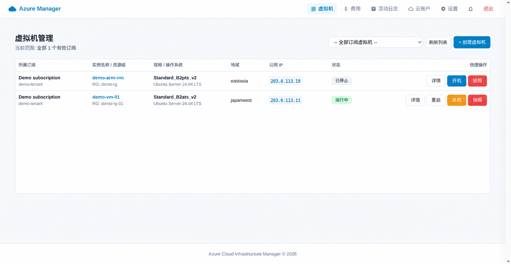

# Azure Manager

Azure Manager 是一个自托管的 Microsoft Azure 多订阅运维管理面板，使用 Python 3.11、Flask、SQLite 和 Azure 官方管理 SDK 构建，适合个人管理员或小型团队集中管理 Azure 虚拟机及相关资源。



## 功能

- 多订阅管理：管理多个 Azure Service Principal，自动发现、同步并按订阅筛选资源。
- 虚拟机生命周期：支持创建、开机、关机释放、重启、销毁、换盘重装、升降配、更换公网 IP 和重置管理员凭据（支持 x64 与 ARM64）。
- 动态探测与缓存：按订阅和地域动态读取可用地域、规格、市场镜像与参考价格，并缓存在本地 SQLite 中。
- 网络与监控计费：管理 NSG 入站规则，查看 CPU、内存、网络、磁盘监控指标及月度累计费用。
- 异步任务与日志：耗时操作由后台任务线程执行，通过顶部提示、通知抽屉和活动日志展示进度与结果。
- 安全与备份：使用 `SECRET_KEY` 加密客户端密码和脚本内容，校验 CSRF，并支持 SQLite 在线备份与校验恢复。

## 环境要求

- Docker Engine 20+ 及 Docker Compose v2
- Azure 租户、订阅及具备目标资源管理权限的 Service Principal

## 部署

在部署服务器上克隆仓库并初始化环境变量：

```bash
sudo mkdir -p /opt/azure-manager
sudo chown "$(id -u):$(id -g)" /opt/azure-manager
git clone https://github.com/buffmio/azure-manager.git /opt/azure-manager
cd /opt/azure-manager
cp .env.example .env
chmod 600 .env
```

生成随机密钥并填入 `.env` 的 `SECRET_KEY`：

```bash
openssl rand -hex 32
```

构建并启动服务：

```bash
docker compose up -d --build
docker compose ps
```

默认监听 `127.0.0.1:8888`，请通过宿主机 HTTPS 反向代理对外提供服务，不要将 8888 端口直接暴露到公网。SQLite 数据保存在 Docker 命名卷 `azure-manager-data` 中。

更新已有部署：

```bash
cd /opt/azure-manager
git pull --ff-only
docker compose up -d --build
```

## 反向代理与配置

宿主机使用 Caddy 时的最简配置（`/etc/caddy/Caddyfile`）：

```caddyfile
panel.example.com {
    reverse_proxy 127.0.0.1:8888
}
```

校验并加载配置：

```bash
sudo caddy validate --config /etc/caddy/Caddyfile
sudo systemctl reload caddy
```

`.env` 可选配置项（修改后执行 `docker compose up -d` 生效）：

| 变量 | 默认值 | 说明 |
| --- | --- | --- |
| `SECRET_KEY` | 必填 | Flask 会话签名及数据库敏感字段加密密钥 |
| `AZURE_MANAGER_BIND` | `127.0.0.1` | 宿主机监听地址（启用代理转发头时必须仅绑定本机） |
| `AZURE_MANAGER_PORT` | `8888` | 宿主机监听端口 |
| `SESSION_COOKIE_SECURE` | `1` | 仅允许通过 HTTPS 发送登录 Cookie |
| `TRUST_PROXY_HOPS` | `0` | 可信反向代理层数（单层反代需记录真实客户端 IP 时设为 `1`） |
| `ENABLE_HSTS` | `0` | 确认全站启用 HTTPS 后可设为 `1` 返回 HSTS 响应头 |
| `TZ` | `Asia/Shanghai` | 容器时区 |

## 初始化与 Azure 凭据

全新数据库首次提交登录表单时，会自动创建第一个管理员账号。

可使用 Azure CLI 创建专用 Service Principal（生产环境建议按最小权限原则配置自定义角色）：

```bash
subscription_id=$(az account show --query id -o tsv)
az ad sp create-for-rbac --name azure-manager-sp --role Contributor --scopes /subscriptions/$subscription_id
```

登录面板后进入“云账户”，填入命令返回的应用 ID（`appId`）、客户端密码（`password`）和租户 ID（`tenant`），等待订阅同步完成即可开始管理资源。

## 备份与恢复

可在面板“设置 -> 数据库备份”中下载或恢复 SQLite 备份，恢复前会自动校验文件格式与基础表完整性。

从宿主机手动备份容器数据时，请先停止服务以避免 SQLite WAL 写入冲突：

```bash
docker compose stop
docker compose cp app:/app/data ./data.backup
docker compose start
```

## 项目结构

```text
azure-manager/
├── azure/
│   ├── app.py              # Flask 路由、任务编排和 API
│   ├── azure_service.py    # Azure SDK 操作和动态探测
│   ├── models.py           # SQLAlchemy 模型和加密字段
│   ├── sku_catalog.py      # 规格目录与零售价格匹配
│   ├── templates/          # Jinja 模板
│   └── static/             # CSS 和前端 JavaScript
├── screenshots/            # 文档截图
├── Dockerfile
├── compose.yaml
├── requirements.txt
├── requirements.lock
└── .env.example
```

## 注意事项

- 保存 Azure 凭据或脚本后不要更换 `SECRET_KEY`；备份文件必须与对应的 `SECRET_KEY` 一起保存，否则加密字段无法解密。
- 不要使用 `docker compose down -v`，否则会删除 `azure-manager-data` 数据卷。若改用宿主机目录挂载 `/app/data`，需确保容器运行用户（UID/GID `10001`）可读写。
- 虚拟机升降配目前仅支持处于 `Running` 或 `Deallocated` 状态的独立 VM；操作会导致停机、临时磁盘数据丢失，动态公网 IP 也可能变化。
- 正式环境部署前，请自行审查源代码、Azure 权限范围和网络安全配置。

## 许可证与致谢

本仓库基于 [1injex/azure-manager](https://github.com/1injex/azure-manager) 二次开发。重新分发时请遵守上游项目许可证并保留适用的版权和许可声明。
